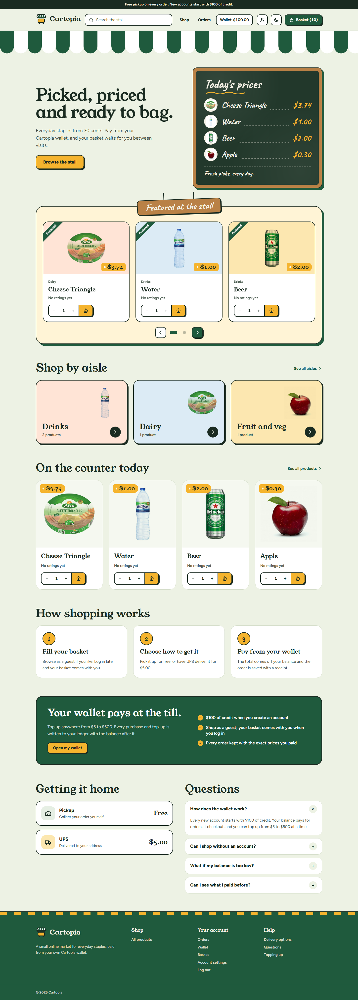
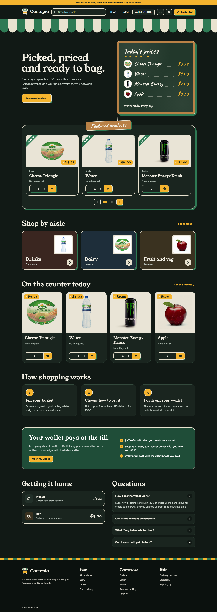
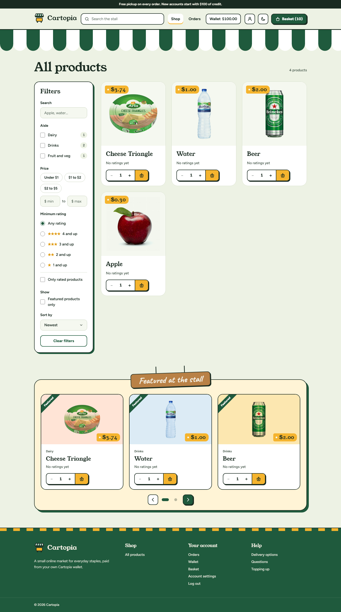
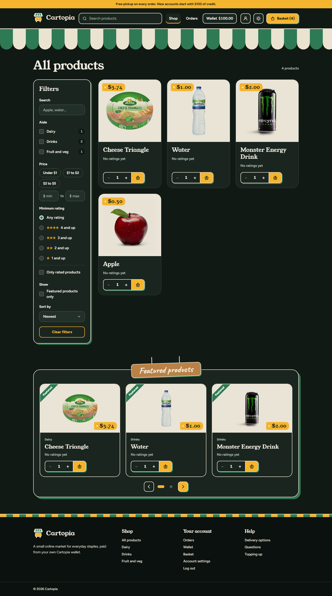
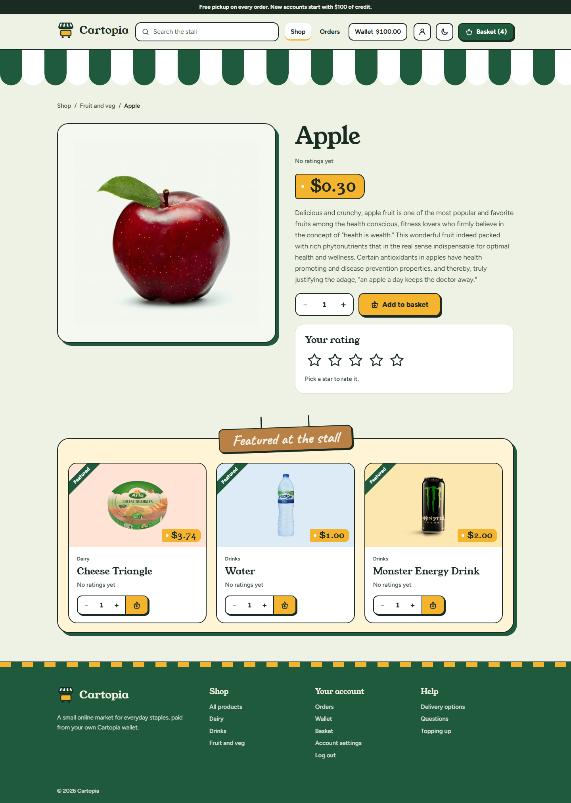
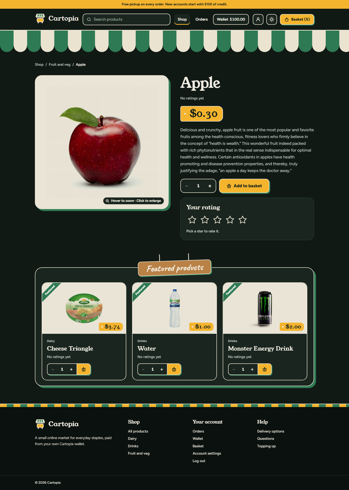
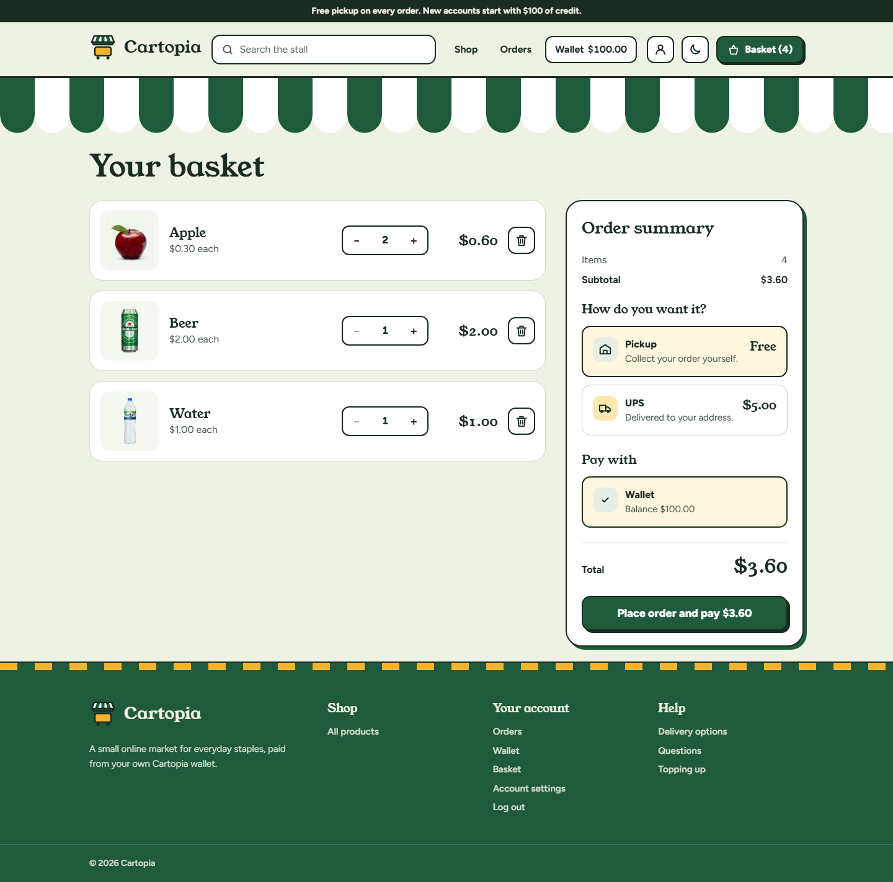
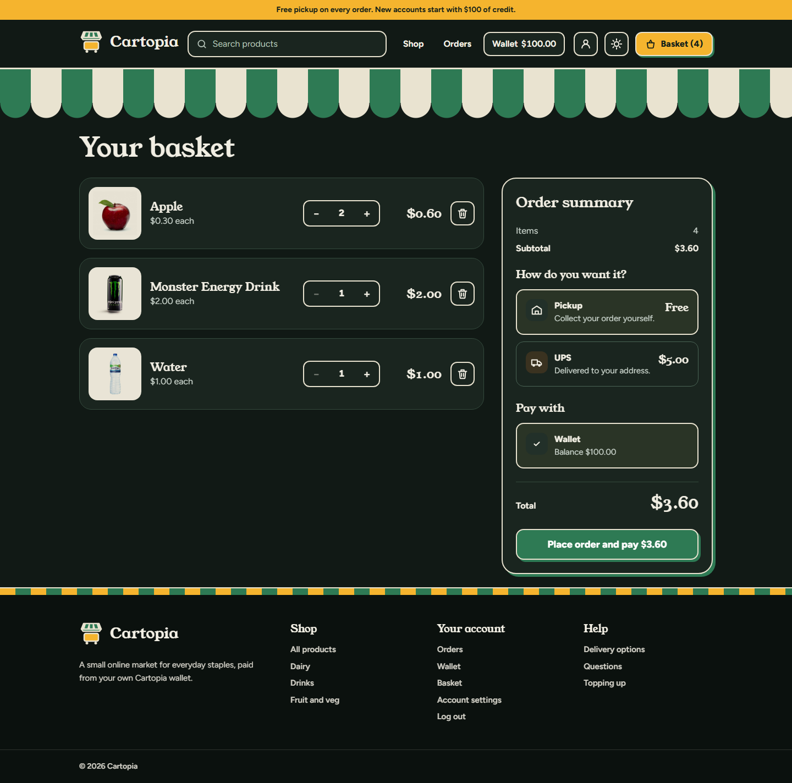
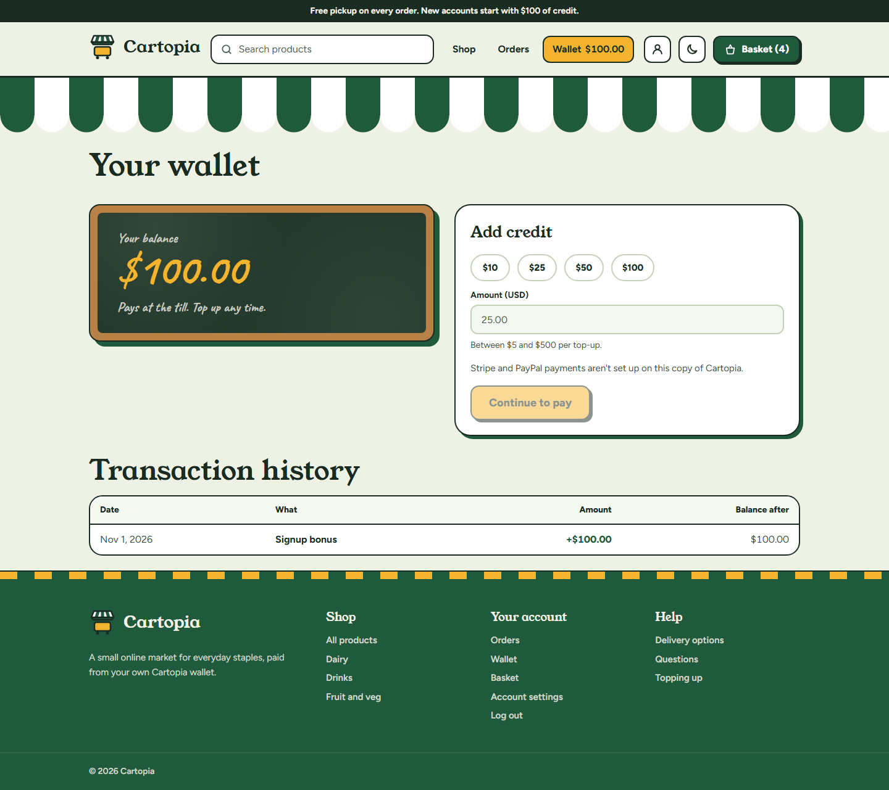
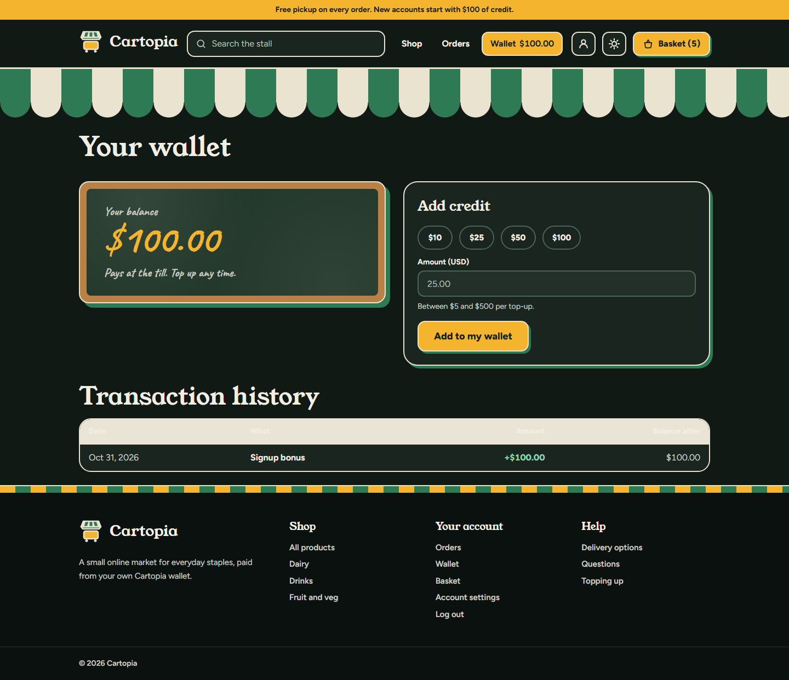

# Cartopia

[](https://github.com/amrcs92/cartopia/actions/workflows/ci.yml)

Cartopia is a small online store with a virtual wallet. Browse and search a catalog, rate products, fill a basket (as a guest or logged in), and pay for orders from your balance. Top up the wallet whenever you like and review every order and ledger entry.

It started in 2018 as a plain-PHP project and was rebuilt in 2026 as a Laravel showcase: modern idioms, a current front end, real tests and CI.

## Screenshots

| Light                                                 | Dark                                                |
| ----------------------------------------------------- | --------------------------------------------------- |
|        |        |
|        |        |
|  |  |
|    |    |
|    |    |

## Stack

- **Backend:** Laravel 13, PHP 8.3, MySQL 8.4
- **Front end:** Inertia 3, Vue 3 + TypeScript, Tailwind 4, shadcn-vue, Laravel Wayfinder, vite-plus
- **Auth:** Laravel Fortify via the official Vue starter kit (login, registration, password reset, profile, optional two-factor and passkeys)
- **Tests:** Pest 4, including browser tests (pest-plugin-browser with Playwright)
- **Quality:** Pint, Larastan level 7, Oxlint, Oxfmt, vue-tsc
- **CI:** GitHub Actions

## Features

- Product catalog with search, price and rating filters, sorting and pagination
- Aisles (categories) with a filter for each, and a featured carousel on the home, shop and product pages
- Product detail with a photo gallery (thumbnails and arrows, a zoom panel on hover, and a full-screen view with swipe on phones) and 1-5 star ratings (one rating per user and product)
- Basket for guests (session) and users (database); a guest basket is merged into the account on login or registration
- An added-to-basket panel that confirms each addition and links to the basket
- Checkout paid from the wallet balance, priced entirely on the server
- Order history with price and name snapshots
- Wallet top-ups ($5-$500) with an append-only transaction ledger
- $100 signup bonus for new accounts
- Light and dark themes, with a toggle in the header
- A friendly not-found page that points back to the home page and the shop

## Setup (Laragon, Windows)

Requirements: Laragon with PHP 8.3, MySQL 8.4 and Node 22.

1. Clone the repository into `C:\laragon\www`:
    ```bash
    git clone https://github.com/amrcs92/cartopia.git C:\laragon\www\cartopia
    cd C:\laragon\www\cartopia
    git checkout laravel
    ```
2. Install PHP dependencies: `composer install`
3. Install JS dependencies: `npm install`
4. Create the environment file with `cp .env.example .env`, create an empty MySQL database named `cartopia`, and set `DB_DATABASE=cartopia` (user `root`, empty password on a default Laragon).
5. Generate the app key: `php artisan key:generate`
6. Migrate and seed: `php artisan migrate --seed`
7. Link public storage (product images): `php artisan storage:link`
8. Build the front end: `npm run build`. This needs `php` on your `PATH`, because Wayfinder generates the route helpers at build time.
9. Open <https://cartopia.test> (Laragon creates the virtual host automatically; turn on SSL under Menu → Apache → SSL → Enabled and reload the web server if needed).

For front-end development use `npm run dev` instead of building.

### Demo logins

| Role  | Email                 | Password   |
| ----- | --------------------- | ---------- |
| Demo  | `amrcs1992@gmail.com` | `12345`    |
| Admin | `admin@cartopia.test` | `password` |

The admin account is used by the Filament admin panel, which is planned as the next sub-project.

## Payments in sandbox mode

Shoppers can pay with Stripe or PayPal, alone or together with their wallet balance, at checkout and when topping up. Both providers run in sandbox mode only, and `.env` is never committed. After editing `.env` run `php artisan config:clear`.

### Setup

1. **Stripe:** copy the test secret key (`sk_test_…`) from the Stripe dashboard into `STRIPE_SECRET`. For the webhook, run the Stripe CLI:
    ```bash
    stripe listen --forward-to https://cartopia.test/webhooks/stripe --skip-verify
    ```
    Put the `whsec_…` secret it prints into `STRIPE_WEBHOOK_SECRET`. `--skip-verify` is needed because Laragon's certificate is self-signed.
2. **PayPal:** in the PayPal Developer dashboard open a sandbox app (Apps & Credentials) and copy its Client ID and Secret into `PAYPAL_CLIENT_ID` and `PAYPAL_SECRET`.
3. **PayPal webhook:** PayPal must reach your machine, so expose it with ngrok (ideally on your free static domain):
    ```bash
    ngrok http http://localhost:80 --host-header=cartopia.test
    ```
    In the sandbox app add a webhook with the URL `https://<ngrok-host>/webhooks/paypal` and these events: `CHECKOUT.ORDER.APPROVED`, `PAYMENT.CAPTURE.COMPLETED` and `PAYMENT.CAPTURE.DENIED`. Copy the webhook's ID into `PAYPAL_WEBHOOK_ID`. Point ngrok at plain HTTP as above: forwarding to `https://cartopia.test` makes Apache pick its virtual host from the TLS connection rather than the rewritten Host header, so PayPal's webhooks get Apache's 404 instead of reaching Cartopia. Use a sandbox Business account in a country that can receive payments (the United States, say): one in Egypt makes every capture fail with `COMPLIANCE_VIOLATION`.
4. **Mail:** start Mailpit from Laragon and set these lines in `.env`. The inbox is at <http://localhost:8025>.
    ```
    MAIL_MAILER=smtp
    MAIL_HOST=127.0.0.1
    MAIL_PORT=1025
    ```
5. **Background work:** run each in its own terminal. Emails only reach Mailpit while the queue worker runs, and the scheduler expires stale payments.
    ```bash
    php artisan queue:work
    php artisan schedule:work
    ```

### Try it

At <https://cartopia.test>:

- [ ] Stripe card `4242 4242 4242 4242` pays and the order is placed.
- [ ] Stripe card `4000 0025 0000 3155` asks for 3-D Secure, then pays.
- [ ] Stripe card `4000 0000 0000 0002` is declined and Stripe keeps you on its page.
- [ ] PayPal pays with the sandbox Personal (buyer) account, and cancelling on PayPal's page returns you to the basket.
- [ ] A split order: with a wallet balance below the total, put the balance towards the order and pay the rest with Stripe or PayPal.
- [ ] A top-up with Stripe and one with PayPal.
- [ ] Pay with each provider and close the tab before returning. The webhook alone settles it: the order shows as placed and the receipt email arrives.
- [ ] Every email appears in Mailpit and reads well in light and dark.

## Quality checks and tests

```bash
composer lint:check      # Pint
composer analyse         # Larastan level 7
npm run lint             # vp lint (Oxlint)
npm run format:check     # vp fmt --check (Oxfmt)
npm run types            # vue-tsc
npm run build
php artisan test         # or: vendor/bin/pest
```

The browser tests need PHP's `sockets` extension. In Laragon enable it under Menu, PHP, Extensions, `sockets`. Alternatively run the tests with `php -d extension=sockets vendor/bin/pest`. Browser tests also need Playwright's browsers (`npx playwright install chromium`). The rest of the suite runs on in-memory SQLite.

## 2018 → 2026 rewrite

The original app (plain PHP, PDO, jQuery, Bootstrap 4 and a localStorage cart) is still in git history on `master` and `main`. The rewrite fixes its defects:

| 2018 defect                                      | 2026 fix                                                                                                                                                 |
| ------------------------------------------------ | -------------------------------------------------------------------------------------------------------------------------------------------------------- |
| Checkout trusted client-side prices and totals   | The server rebuilds the basket from current database prices; the request carries no price, and order totals are computed in a `PlaceOrder` action        |
| Balance updates had no transaction and no lock   | Every balance change goes through a `Wallet` service: one DB transaction, `lockForUpdate`, and a ledger row, so the balance always equals the ledger sum |
| Orders were not linked to users                  | Orders belong to a user, are protected by an `OrderPolicy`, and snapshot item names and prices                                                           |
| One shared fixed salt with SHA-512 for passwords | Laravel's hasher (bcrypt) with per-password salts, via Fortify                                                                                           |
| No output escaping (XSS) and no CSRF protection  | Vue templates escape by default; Inertia and Laravel send CSRF tokens on every form                                                                      |
| Ratings were unvalidated and could be duplicated | Form request validation (1-5 stars) and a unique `(user_id, product_id)` constraint with `updateOrCreate`                                                |
| N+1 queries on every listing page                | Eager loading (`primaryImage`, `withAvg`, `withCount`) and paginated queries                                                                             |

All money is stored as integer cents and wrapped in a `Money` value object, with no float arithmetic and no money math in the browser.
