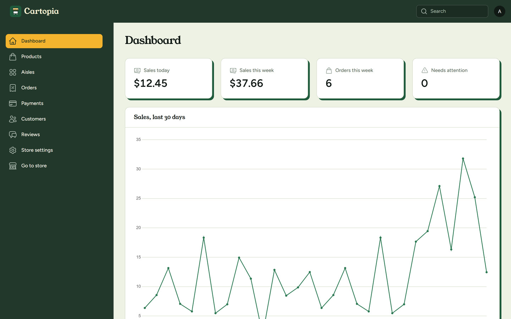

# Admin panel

A Filament back office at <https://cartopia.test/admin>.

## Access

Sign in with the seeded admin from the [demo logins](setup.md#demo-logins). Anyone who is not an admin gets the store's not-found page. Admins see an "Admin" link in the account menu.

## Screens

- **Dashboard:** sales overview, a sales chart and the latest orders.
- **Products:** add, edit, feature and move products between aisles. Photos are JPG or WebP, under 1 MB, square and at least 1200 × 1200px, up to five per product. Hide a product rather than deleting it.
- **Aisles:** add and rename the store's categories, with a product count for each.
- **Orders:** browse and open orders, and refund them.
- **Payments:** every Stripe and PayPal payment. The "Needs attention" tab lists payments still pending more than 30 minutes after they started, and "Check with provider" asks Stripe or PayPal for the payment's current state.
- **Customers:** accounts with their orders and wallet ledger. "Adjust wallet" credits or debits a balance, and "Make admin" or "Remove admin" changes who can sign in to the panel.
- **Reviews:** every customer review, filterable by product and by hidden or visible. "Hide" takes a review off the product page and out of its average without deleting it, "Unhide" brings it back, and "Delete" removes it.
- **Store settings:** the sign-up credit new accounts get, from $0 to $500. The store's copy follows it, and $0 turns the credit and the copy off.

## Refunds in sandbox

Only a whole order can be refunded. The part paid from the wallet goes back to the wallet, and the Stripe or PayPal part goes back through the provider's sandbox. If the provider refuses the refund or can't be reached, "Retry refund" appears on the order. The shopper gets a refund receipt email, which shows up in Mailpit while the queue worker runs. Stripe and PayPal refunds also appear in each provider's sandbox dashboard.

## Look

The panel uses a custom theme that matches the store, in `resources/css/filament/admin/theme.css`. `npm run build` builds it.
